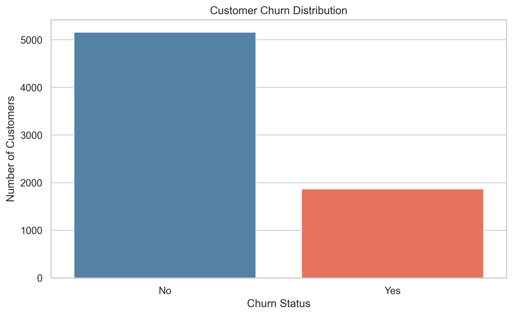
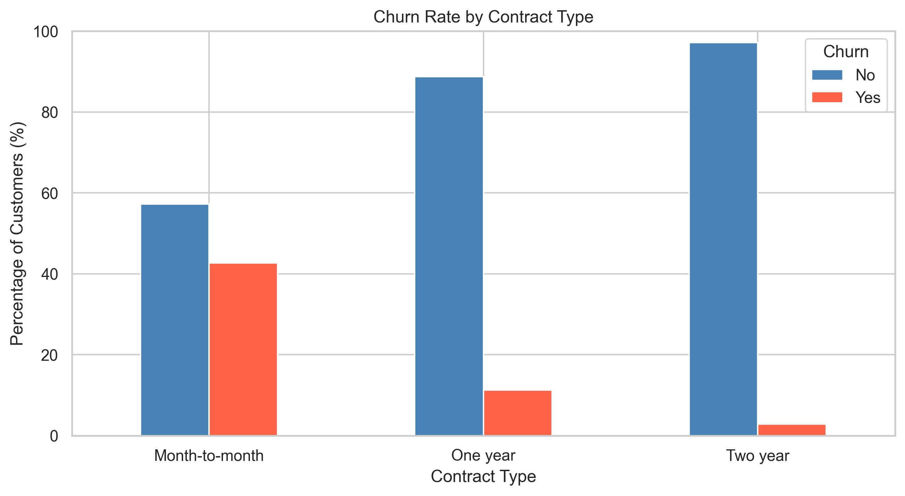
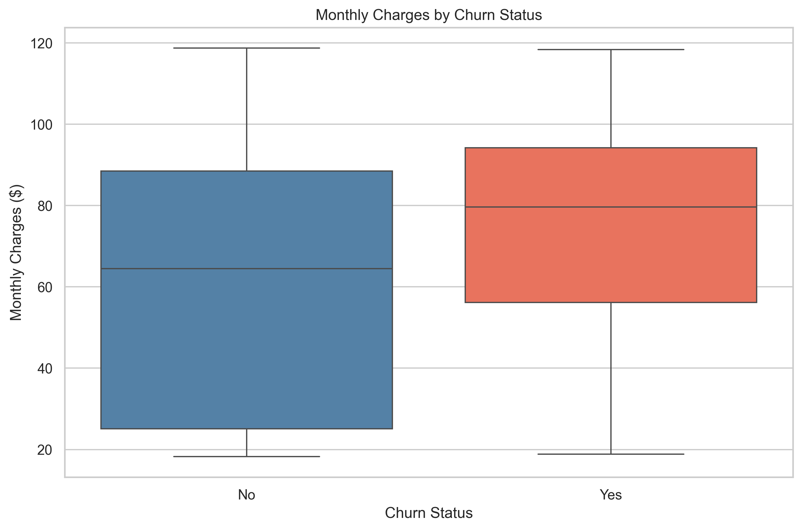
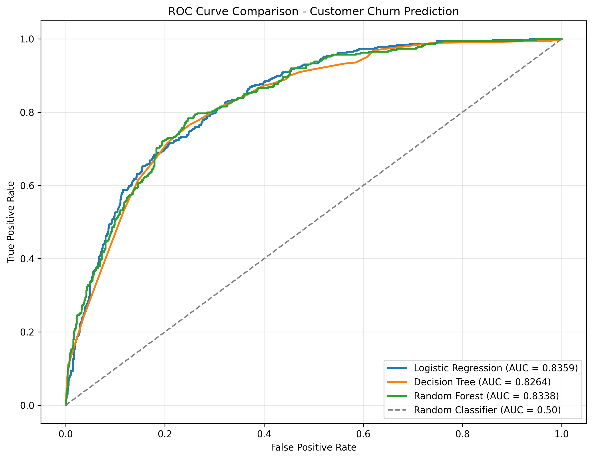
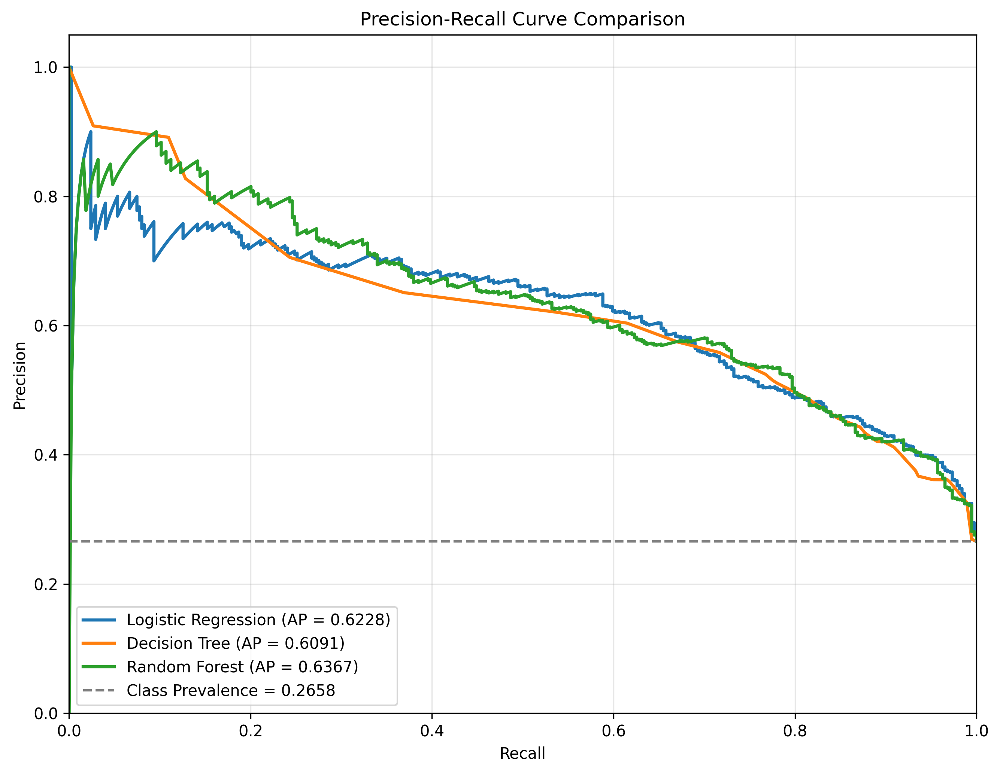
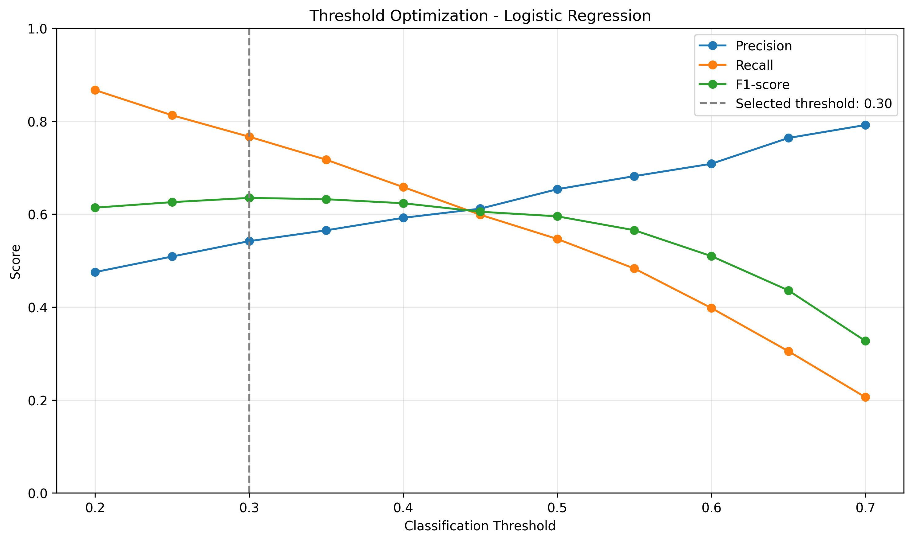

# Customer Churn Prediction

**Customer churn analysis and classification using Python and scikit-learn**

## Overview

Customer churn is an important consideration for subscription-based businesses. Identifying customers who may leave can help organizations better understand retention risks and prioritize further investigation.

This project uses the IBM Telco Customer Churn dataset to explore customer behavior and compare machine learning approaches for binary churn classification.

The work covers the full modeling process, from data cleaning and exploratory analysis to preprocessing, model evaluation, hyperparameter tuning, threshold selection, and prediction using a saved pipeline.

The main focus is not simply maximizing accuracy, but understanding the trade-off between identifying customers who may churn and incorrectly flagging customers who are likely to stay.

## Dataset

The project uses the publicly available IBM Telco Customer Churn dataset.

**Source:** [IBM Telco Customer Churn](https://github.com/IBM/telco-customer-churn-on-icp4d)

The original dataset contains 7,043 customer records with information about customer demographics, subscribed services, contracts, payment methods, and billing.

During data preparation:

- `TotalCharges` was converted to a numeric variable.
- Eleven records with missing `TotalCharges` values were identified and excluded.
- Customer identifiers were excluded from the predictive features.
- The target variable was encoded as 0 (No Churn) and 1 (Churn).

The cleaned dataset contains **7,032 customer records**, with 19 input features and a binary target.

Approximately 26.58% of the customers in the cleaned dataset had churned.

The dataset files are not included in this repository. To reproduce the analysis, obtain the original dataset from its source and place it in the `data` directory as `Telco-Customer-Churn.csv`.

## Exploratory Data Analysis

Exploratory analysis highlighted several patterns:

- Customers with month-to-month contracts had a substantially higher observed churn rate than those with longer contracts.
- Churn was more common among customers with shorter tenure.
- Customers who churned had higher average monthly charges.

These are associations observed in the dataset, not evidence of causation.

### Churn Distribution



### Churn by Contract Type



### Monthly Charges and Churn



Additional exploratory findings are documented in [EDA Summary](reports/eda_summary.md).

## Modeling Approach

The data was divided into an 80% training set and a 20% test set using a stratified split.

The modeling workflow uses scikit-learn Pipelines and column-specific preprocessing to prepare numerical and categorical features.

Three classification algorithms were evaluated:

1. Logistic Regression
2. Decision Tree
3. Random Forest

A majority-class DummyClassifier provided a baseline for comparison.

Evaluation included accuracy, precision, recall, F1-score, ROC-AUC, and Average Precision. Cross-validation and threshold analysis were used to investigate model behavior beyond a single accuracy score.

## Model Results

The initial models produced the following results on the 1,407-record test set, using a classification threshold of 0.50.

| Model | Accuracy | Precision | Recall | F1-score | ROC-AUC |
|---|---:|---:|---:|---:|---:|
| Logistic Regression | 0.8038 | 0.6485 | 0.5722 | 0.6080 | 0.8359 |
| Decision Tree | 0.7903 | 0.6037 | 0.6150 | 0.6093 | 0.8264 |
| Random Forest | 0.7939 | 0.6409 | 0.5107 | 0.5685 | 0.8338 |

Precision, recall, and F1-score refer to the churn class.

Logistic Regression achieved the highest ROC-AUC in the initial test comparison. Decision Tree identified a slightly larger proportion of churned customers at the default threshold.

Random Forest achieved the highest Average Precision (0.6367), compared with 0.6228 for Logistic Regression and 0.6091 for Decision Tree.

The differences between these models should be interpreted cautiously rather than treated as evidence of a statistically significant advantage.

### ROC Curve Comparison



### Precision–Recall Comparison



## Threshold Optimization

The initial Logistic Regression model was evaluated at different classification thresholds.

Reducing the threshold from 0.50 to 0.30 increased test-set recall from **0.5722 to 0.7594**.

This identified 70 additional customers who had churned, but also produced 156 additional false-positive predictions.

The result illustrates an important trade-off: a lower threshold can identify more potentially at-risk customers, but may also increase unnecessary retention interventions.



## Hyperparameter Tuning and Nested Cross-Validation

Logistic Regression was subsequently tuned using GridSearchCV, with ROC-AUC as the selection metric.

The selected final configuration used:

- `C = 10.0`
- `class_weight = None`
- Classification threshold = `0.30`

The best five-fold tuning ROC-AUC was **0.8463**.

Nested cross-validation was performed on the original training subset to assess the hyperparameter and threshold-selection procedure.

It used five outer folds and three inner folds.

| Metric | Nested CV Mean | Standard Deviation |
|---|---:|---:|
| Accuracy | 0.7685 | 0.0109 |
| Precision | 0.5479 | 0.0161 |
| Recall | 0.7445 | 0.0453 |
| F1-score | 0.6306 | 0.0197 |
| ROC-AUC | 0.8463 | 0.0056 |

The selected classification threshold varied across the outer folds, indicating that threshold selection is sensitive to the training sample.

These nested cross-validation results assess the Logistic Regression tuning procedure. They are not an independent evaluation of the full process used to compare and choose among all model families.

## Final Model and Prediction

The saved final model uses Logistic Regression within a preprocessing pipeline.

The training script saves the fitted model and a separate configuration file containing the selected classification threshold and expected feature order.

The inference script loads these files and applies the same preprocessing to new customer records.

For demonstration, a synthetic customer with a month-to-month contract, three months of tenure, fiber optic internet, and monthly charges of $95 was evaluated.

The model produced:

| Output | Value |
|---|---|
| Estimated churn probability | 71.45% |
| Classification threshold | 0.30 |
| Predicted class | Churn |

This is an illustrative model prediction, not a verified outcome or a calibrated probability guarantee.

## Project Structure

```text
Customer_Churn_Prediction/
├── data/
│   ├── Telco-Customer-Churn.csv          # Download separately
│   └── Telco-Customer-Churn-Cleaned.csv  # Generated locally
├── models/
│   ├── final_churn_model.joblib          # Generated locally
│   └── final_model_config.json
├── reports/
│   ├── figures/
│   ├── eda_summary.md
│   ├── final_model_summary.md
│   └── *.csv
├── src/
│   ├── check_data.py
│   ├── clean_data.py
│   ├── eda.py
│   ├── preprocessing.py
│   ├── baseline_model.py
│   ├── train_logistic_regression.py
│   ├── train_decision_tree.py
│   ├── train_random_forest.py
│   ├── threshold_optimization.py
│   ├── evaluate_threshold.py
│   ├── hyperparameter_tuning.py
│   ├── nested_cross_validation.py
│   ├── model_visualization.py
│   ├── train_final_model.py
│   └── predict_customer.py
├── .gitignore
├── requirements.txt
└── README.md
```

The original and cleaned datasets, Python virtual environment, and fitted `.joblib` model are excluded from version control.

## Installation

The following instructions are intended for Windows PowerShell.

### 1. Clone the repository

```powershell
git clone https://github.com/kabani-kh/Customer_Churn_Prediction.git
cd Customer_Churn_Prediction
```

### 2. Create and activate a virtual environment

```powershell
python -m venv .venv
.\.venv\Scripts\Activate.ps1
```

### 3. Install the dependencies

```powershell
python -m pip install -r requirements.txt
```

## Running the Project

### 1. Prepare the dataset

First, create the data directory if it does not already exist:

```powershell
New-Item -ItemType Directory -Force data
```

Download the original IBM Telco Customer Churn CSV and save it as:

`data/Telco-Customer-Churn.csv`

Then run the cleaning script:

```powershell
python src/clean_data.py
```

This creates the cleaned dataset required by the modeling scripts.

Then run the cleaning script:

```powershell
python src/clean_data.py
```

This creates the cleaned dataset required by the modeling scripts.

### 2. Explore the data

```powershell
python src/eda.py
```

### 3. Train the final model

```powershell
python src/train_final_model.py
```

This generates the fitted model and its configuration in the `models` directory.

### 4. Run an example prediction

```powershell
python src/predict_customer.py
```

The prediction script currently demonstrates inference using a predefined synthetic customer profile. It is not a deployed customer-facing application.

Individual training, tuning, evaluation, and visualization scripts are also available in the `src` directory.

## Limitations

This is an educational machine learning project based on a public demonstration dataset.

The original test set was inspected during exploratory comparisons, so those results should not be presented as an untouched evaluation of the final selected workflow.

Nested cross-validation provides a more suitable assessment of the Logistic Regression tuning procedure, although model-family selection was not fully nested.

The model has not been validated using newly collected customer data. Probability calibration, business-specific intervention costs, and deployment monitoring have not been evaluated.

Feature associations should not be interpreted as causal effects, and predicted churn does not necessarily imply that a retention intervention would be successful.

## Documentation

For the complete analysis, detailed metrics, threshold comparisons, feature importance, and methodological limitations, see:

**[Full Model Evaluation Report](reports/final_model_summary.md)**

Additional numerical outputs and visualization files are available in the `reports` directory.

## Tools and Libraries

- Python
- pandas and NumPy
- scikit-learn
- Matplotlib and Seaborn
- Joblib
- Git and GitHub

## Data Attribution

The dataset used in this project comes from the IBM Telco Customer Churn example.

[Original IBM repository](https://github.com/IBM/telco-customer-churn-on-icp4d)

This repository documents an independent educational and portfolio project. It is not affiliated with or endorsed by IBM.